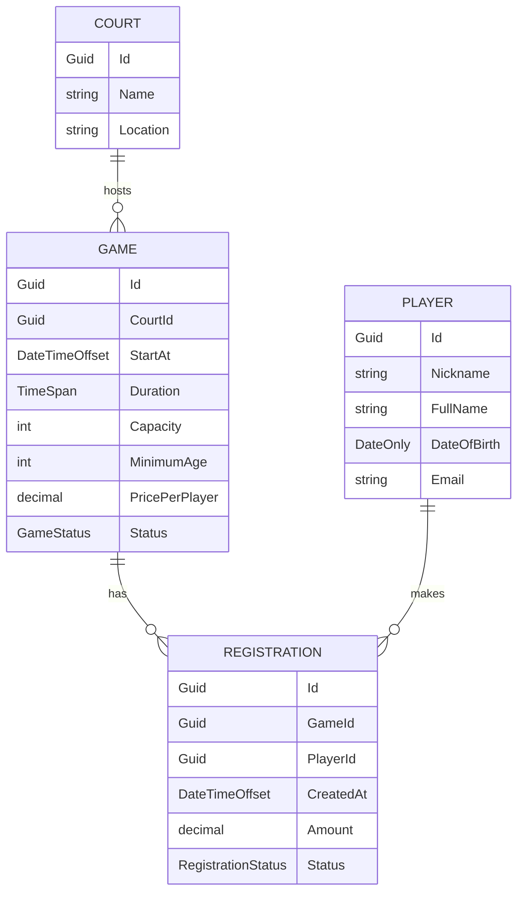

# Dominio de CourtConnect

## Descripción

CourtConnect permite organizar partidos de baloncesto en canchas concretas. Un organizador publica un partido con fecha, duración, plazas, edad mínima y precio; los jugadores pueden inscribirse mientras esté abierto y antes de que empiece. En esta primera parte, las inscripciones se confirman al crearse y pueden cancelarse antes del inicio.

## Glosario español–inglés del dominio

| Español | Código |
| --- | --- |
| Cancha | `Court` |
| Partido | `Game` |
| Jugador | `Player` |
| Inscripción | `Registration` |
| Borrador | `Draft` |
| Abierto | `Open` |
| Cerrado | `Closed` |
| Confirmada | `Confirmed` |
| Cancelada | `Cancelled` |

## Diagrama entidad-relación

Una inscripción relaciona exactamente un jugador con un partido. El partido mantiene sus inscripciones y es el punto de entrada para inscribir o cancelar, de modo que las reglas que dependen del conjunto de inscripciones no se dejan a la API.

## Reglas de negocio

| Regla | Entidad responsable | Justificación |
| --- | --- | --- |
| R1 | `Game` | El partido conoce su capacidad y cuenta las inscripciones confirmadas. La comprobación en memoria no resuelve por sí sola dos peticiones simultáneas; la persistencia deberá proteger también esa operación. |
| R2 | `Game` | El partido puede buscar si ese jugador ya tiene una inscripción confirmada y evitar duplicarla. Una cancelada no cuenta como activa. |
| R3 | `Game` y `Player` | `Player` calcula la edad en la fecha del partido; `Game` impone su edad mínima y no permite configurar una inferior a 16. |
| R4 | `Game` | El partido conoce su estado y su hora de inicio, así que rechaza inscripciones si no está abierto o ya ha empezado. |
| R5 | `Game` y `Registration` | `Game` comprueba la hora y que la inscripción le pertenezca; `Registration` cambia su estado a cancelada. El recuento de activas libera la plaza. |
| R6 | `Game` y `Registration` | `Game` copia el precio vigente al crear la inscripción. `Registration.Amount` conserva ese importe como dato histórico. |

## Decisiones de diseño

### Inscripción simultánea en la última plaza

`Game.Register` comprueba la capacidad antes de añadir la inscripción, lo que cubre las llamadas secuenciales dentro de una instancia. No evita una carrera entre dos peticiones concurrentes que lean el mismo estado. Al añadir persistencia, la operación tendrá que ser atómica en la base de datos (por ejemplo, con una transacción y control de concurrencia) y probar el conflicto. No se afirma que la versión en memoria ya resuelva esa concurrencia.

### Datos de jugador y edad mínima

Se guardan apodo, nombre, fecha de nacimiento y correo porque son los datos descritos por el enunciado. No se guardan teléfono, foto ni datos de salud, que no hacen falta para organizar el partido. El constructor recibe la fecha de alta para validar la edad de forma determinista; así no depende del reloj del equipo ni dificulta los tests.

La plataforma admite jugadores desde los 16 años. Además, cada partido puede exigir una edad superior, calculada en la fecha local representada por la hora del partido.

### Zona horaria y cambio de hora

`Game.StartAt` y `Registration.CreatedAt` se representan con `DateTimeOffset`, que conserva el desplazamiento UTC y permite comparar instantes. La fecha y hora del partido se interpreta en la zona de la cancha; para CourtConnect en Barcelona, el borde de entrada debe resolverla con `Europe/Madrid` y convertirla a un `DateTimeOffset`.

En el cambio de octubre, la hora local repetida corresponde a dos instantes distintos: se debe conservar el desplazamiento elegido para distinguirlos. Una hora local inexistente durante el cambio de primavera debe rechazarse al convertirla. La interfaz de entrada y esa conversión se implementarán en capas posteriores; el dominio recibe el instante ya resuelto.

### Comunicación de reglas incumplidas

Los métodos del dominio lanzan excepciones cuando se incumple una regla. En este ejercicio se usan `ArgumentException`/`ArgumentOutOfRangeException` para datos inválidos y `InvalidOperationException` para acciones incompatibles con el estado del partido o la inscripción. La API traducirá estos errores a respuestas HTTP en una parte posterior.

### Otras decisiones

- Las entidades son clases con identidad propia; sus propiedades no tienen `set` público.
- La inscripción se crea mediante `Game.Register`, no con un constructor público que permita saltarse las reglas.
- Cancelar dos veces se considera un uso inválido y lanza `InvalidOperationException`.
- El dominio no depende de ASP.NET Core ni de EF Core. La persistencia y la API se añadirán en ejercicios posteriores.
